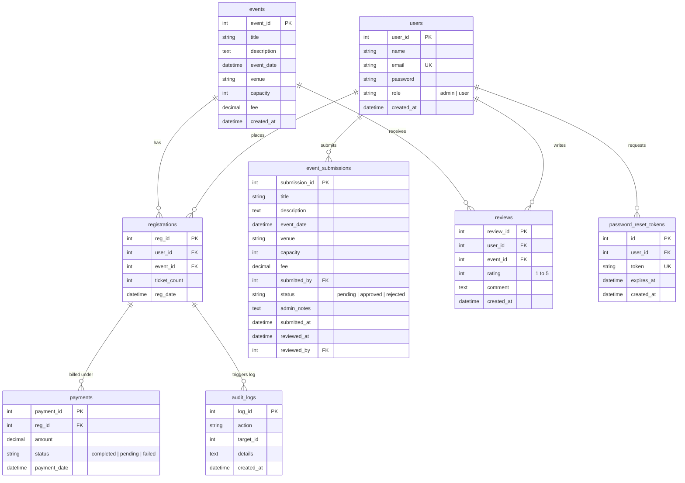

# 📊 Evantra DBMS - Comprehensive Database Documentation

This document describes the schema architecture, entities, relationships, constraints, views, triggers, and indexes used in the **Evantra Event Management System**.

---

## 🏛️ System Architecture & Dual-Engine Support

Evantra features a flexible database abstraction layer in `db.js`:
- **Production Mode:** MySQL 8.0+ Connection Pool (utilizing transactions, triggers, and prepared statements).
- **Development / Standalone Mode:** Embedded zero-configuration SQLite engine powered by Node.js v24 native `node:sqlite` (`event_db.sqlite`).

---

## 🗄️ Relational Schema Diagram (ER Diagram)



---

## 📋 Entity Catalog & Constraints

### 1. `users`
| Column | Type | Constraints | Description |
|---|---|---|---|
| `user_id` | INT / INTEGER | PRIMARY KEY, AUTO_INCREMENT | Unique identifier for user |
| `name` | VARCHAR(100) / TEXT | NOT NULL | User's full name |
| `email` | VARCHAR(100) / TEXT | NOT NULL, UNIQUE | User login email |
| `password` | VARCHAR(255) / TEXT | NOT NULL | Bcrypt / hashed credential |
| `role` | VARCHAR(20) / TEXT | DEFAULT 'user' | Access control ('admin' or 'user') |
| `created_at` | DATETIME | DEFAULT CURRENT_TIMESTAMP | Account creation timestamp |

### 2. `events`
| Column | Type | Constraints | Description |
|---|---|---|---|
| `event_id` | INT / INTEGER | PRIMARY KEY, AUTO_INCREMENT | Unique identifier for event |
| `title` | VARCHAR(150) / TEXT | NOT NULL | Name of the event |
| `description` | TEXT | NULL | Complete overview and schedule |
| `event_date` | DATETIME | NOT NULL | Date and time of the event |
| `venue` | VARCHAR(255) / TEXT | NOT NULL | Physical venue or virtual link |
| `capacity` | INT / INTEGER | NOT NULL, CHECK (capacity >= 0) | Maximum attendees |
| `fee` | DECIMAL(10,2) / NUMERIC | DEFAULT 0.00 | Ticket cost in INR |
| `created_at` | DATETIME | DEFAULT CURRENT_TIMESTAMP | Record creation timestamp |

### 3. `registrations`
| Column | Type | Constraints | Description |
|---|---|---|---|
| `reg_id` | INT / INTEGER | PRIMARY KEY, AUTO_INCREMENT | Registration transaction ID |
| `user_id` | INT / INTEGER | FK -> `users.user_id` ON DELETE CASCADE | Attending user |
| `event_id` | INT / INTEGER | FK -> `events.event_id` ON DELETE CASCADE | Target event |
| `ticket_count` | INT / INTEGER | DEFAULT 1 | Number of tickets booked |
| `reg_date` | DATETIME | DEFAULT CURRENT_TIMESTAMP | Booking timestamp |
| *(Composite)* | UNIQUE | `UNIQUE(user_id, event_id)` | Prevents duplicate active bookings |

### 4. `payments`
| Column | Type | Constraints | Description |
|---|---|---|---|
| `payment_id` | INT / INTEGER | PRIMARY KEY, AUTO_INCREMENT | Unique receipt ID |
| `reg_id` | INT / INTEGER | FK -> `registrations.reg_id` ON DELETE CASCADE | Booking reference |
| `amount` | DECIMAL(10,2) / NUMERIC | NOT NULL | Amount paid in INR |
| `status` | VARCHAR(50) / TEXT | DEFAULT 'completed' | Payment status |
| `payment_date` | DATETIME | DEFAULT CURRENT_TIMESTAMP | Transaction timestamp |

### 5. `event_submissions`
Handles user-submitted event proposals submitted for admin review and approval.

### 6. `reviews`
Stores participant ratings (1 to 5 stars) and feedback comments for events.

### 7. `audit_logs`
Automated compliance log populated by database triggers on critical business actions.

---

## 🔍 Database Views

### View 1: `event_summary_view`
Aggregates real-time ticket sales and capacity calculation without requiring multiple joins in application routes:
```sql
CREATE VIEW event_summary_view AS
SELECT 
  e.event_id,
  e.title,
  e.event_date,
  e.venue,
  e.capacity,
  e.fee,
  COALESCE(SUM(r.ticket_count), 0) AS total_tickets_sold,
  (e.capacity - COALESCE(SUM(r.ticket_count), 0)) AS remaining_seats
FROM events e
LEFT JOIN registrations r ON e.event_id = r.event_id
GROUP BY e.event_id;
```

### View 2: `user_booking_view`
Provides consolidated booking histories for users including event metadata and payment status:
```sql
CREATE VIEW user_booking_view AS
SELECT 
  r.reg_id,
  r.user_id,
  r.event_id,
  r.ticket_count,
  r.reg_date,
  e.title AS event_title,
  e.event_date,
  e.venue,
  e.fee,
  p.payment_id,
  p.amount AS amount_paid,
  p.status AS payment_status
FROM registrations r
JOIN events e ON r.event_id = e.event_id
LEFT JOIN payments p ON r.reg_id = p.reg_id;
```

---

## ⚡ Triggers

### Trigger: `trg_after_registration`
Automatically logs every ticket reservation into the `audit_logs` table:
```sql
CREATE TRIGGER trg_after_registration
AFTER INSERT ON registrations
FOR EACH ROW
BEGIN
  INSERT INTO audit_logs (action, target_id, details)
  VALUES ('NEW_REGISTRATION', NEW.reg_id, 'User #' || NEW.user_id || ' booked ' || NEW.ticket_count || ' ticket(s) for Event #' || NEW.event_id);
END;
```

---

## 🚀 Performance Indexes

- `idx_events_date` on `events(event_date)`: Accelerates sorting and filtering upcoming events.
- `idx_registrations_user` on `registrations(user_id)`: Accelerates user booking lookups on profile dashboards.
- `idx_registrations_event` on `registrations(event_id)`: Speeds up capacity aggregation and participant rosters.
- `idx_payments_reg` on `payments(reg_id)`: Accelerates 1-to-1 payment verification.

